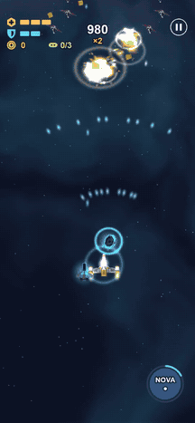
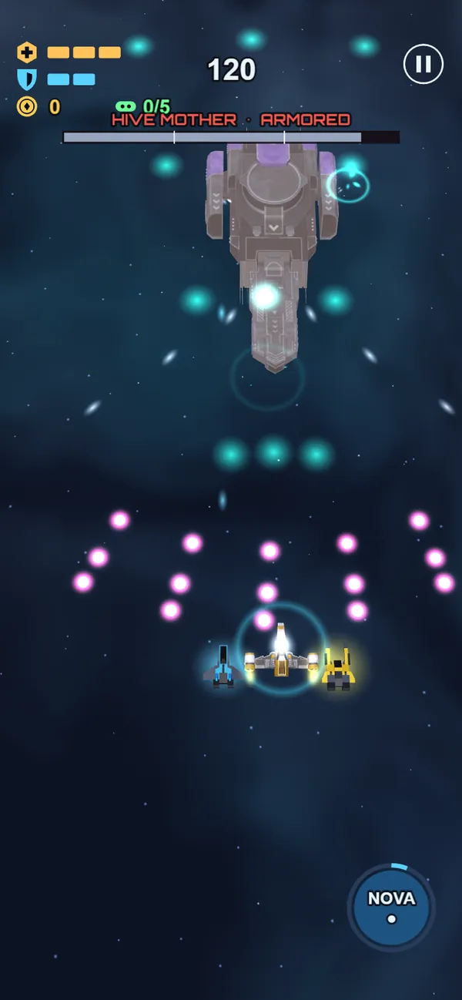
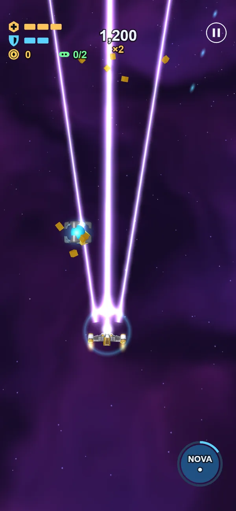
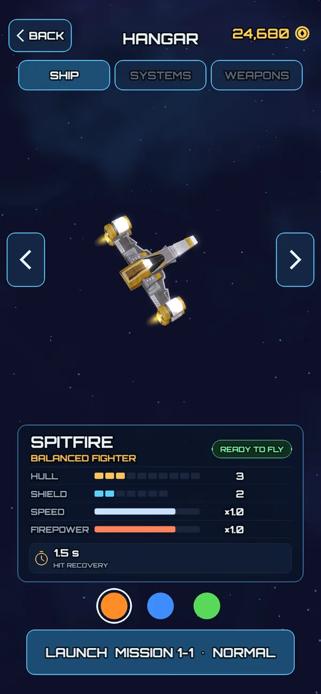

# Space Flight

[Русский](README.md) · **English**

A vertical 2.5D shoot 'em up for phones: low-poly 3D ships, a top-down camera and one-finger controls. A three-sector campaign with bosses, medals, four difficulty levels and an upgrade hangar. Free and ad-free: play it in the browser, add it to the home screen, or install the Android and iPhone apps.

**▶ Play:** https://spaceflight.p1gog.duckdns.org/ · **Game page:** https://spaceflight.p1gog.duckdns.org/about/

<p>
  
  
  
  
</p>

**Status:** version 1.0, the project is complete. The main release is a PWA; the Android APK and the iPhone `.ipa` are built on GitHub Actions and can be downloaded from the [game page](https://spaceflight.p1gog.duckdns.org/about/). Development history is in [docs/PLAN.md](docs/PLAN.md) (in Russian, like the rest of the docs).

## The game in brief

- Your ship follows your finger and fires on its own. A shield and hull keep you alive, and for tight spots there is a Special: Nova Bomb, Overdrive, Phase Shield or Time Warp.
- 6 primary guns, 4 secondary weapons, 3 drones. Weapons power up to Power IV during a mission; between missions you buy upgrades with credits in the hangar. Three ships, each in three color schemes.
- 9 missions across 3 sectors (Outer Ring, Ice Moons, Nebula Drift): six mini-bosses and three bosses — Warden, Hive Mother, Leviathan. Every mission has 4 medals: Hunter, Exterminator, Rescuer, Untouchable.
- Normal, Hard, Insane and Nightmare difficulties; elite enemies.
- Inspired by Sky Force Reloaded and Tyrian 2000. Full design in [docs/GDD.md](docs/GDD.md).

## Tech

| | |
|---|---|
| Engine | [Cocos Creator 3.8 LTS](https://docs.cocos.com/creator/3.8/manual/en/) |
| Language | TypeScript |
| Platforms | Web / PWA on a self-hosted VPS (main release); Android (APK) and iOS (unsigned `.ipa`, installed with Sideloadly), built on GitHub Actions |
| Tests | Vitest (pure logic), Playwright (visual playtests) |
| Assets | Free only: CC0 and similar (Quaternius, Kenney…), see [docs/ASSETS.md](docs/ASSETS.md) |

## Quick start

### 1. Install

1. Install [Node.js](https://nodejs.org/) 20+ (the project is developed on 24).
2. Download and install [Cocos Dashboard](https://www.cocos.com/en/creator-download). You can skip "Install Visual Studio 2022": it is only needed for native Windows builds.
3. In Dashboard → **Installs**, install **Cocos Creator 3.8.x** (the project uses 3.8.8).

### 2. Open the project

Dashboard → **Projects** → **Add** → the `game/` folder of this repository.

### 3. Run

- **In the browser:** press ▶ **Preview** in the editor; it opens `http://localhost:7456`.
- **On an iPhone:** with the phone on the same Wi‑Fi network, hover over the IP address in the editor toolbar and scan the QR code — the game opens in Safari.
- **Tests and type checking:** `npm install`, then `npm test` and `npm run typecheck` (typecheck needs the project to have been opened in the editor at least once).

## Layout

```
docs/          documentation: GDD, plan, architecture, assets, platforms
game/          the Cocos Creator project (assets/, settings/, native/)
tests/         unit tests for the pure logic
site/          the game page (/about/): description, video, screenshots, install guide
tools/         scripts: asset pipelines, balance, web build and deploy, CI
build-configs/ Cocos build configs for the CLI and CI
youtube/       capture and editing of the YouTube Shorts video
.github/       GitHub Actions: APK and .ipa builds
.claude/       Claude Code settings and skills
```

More in [docs/ARCHITECTURE.md](docs/ARCHITECTURE.md).

## Documentation

All documents are in Russian.

| Document | Contents |
|---|---|
| [docs/GDD.md](docs/GDD.md) | Game design: mechanics, weapons, enemies, bosses, campaign, economy |
| [docs/PLAN.md](docs/PLAN.md) | Development stages and what each delivered |
| [docs/ARCHITECTURE.md](docs/ARCHITECTURE.md) | Code structure and performance budgets |
| [docs/BALANCE.md](docs/BALANCE.md) | Weapon and economy balance table (generated by `npm run balance`) |
| [docs/ASSETS.md](docs/ASSETS.md) | Art and audio sources, licenses, credits |
| [docs/PLATFORMS.md](docs/PLATFORMS.md) | Web, iOS (including without a Mac), Android |
| [docs/SECURITY_REPORT.md](docs/SECURITY_REPORT.md) | Security audit of the build and the server |
| [CLAUDE.md](CLAUDE.md) | Development rules for Claude Code |
| [prd.md](prd.md) | The original brief |

## Developing with Claude Code

Connected:
- **Context7** — up-to-date Cocos documentation.
- **Playwright MCP** — browser playtests (`.mcp.json`).
- **Funplay Cocos MCP** — editor control and scene screenshots. The server listens on `127.0.0.1:28456` while the editor is open. The extension is not stored in git; to install it:
  ```bash
  git clone --depth 1 https://github.com/FunplayAI/funplay-cocos-mcp.git game/extensions/funplay-cocos-mcp
  ```
  Then restart the editor.

Project skills live in `.claude/skills/`: `playtest`, `add-asset`, `add-enemy`, `add-mission`, `add-weapon`.

## Licenses

- **Assets:** authors and licenses are listed in the Credits table in [docs/ASSETS.md](docs/ASSETS.md).
- **Code:** no license chosen yet.
